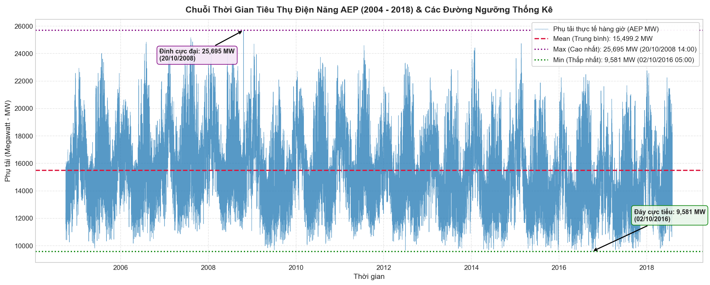
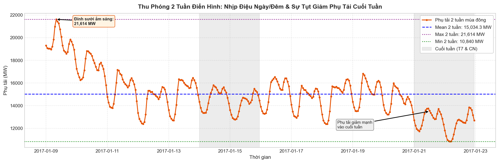

# Tiền Xử Lý & Khám Phá Dữ Liệu Chuỗi Thời Gian (Data Preparation & EDA)

Tài liệu này chi tiết hóa toàn bộ quy trình kiểm tra chất lượng dữ liệu, xử lý tính liên tục thời gian (Daylight Saving Time, mốc trùng lặp / thiếu hụt), thống kê mô tả (`describe`) và phân tích trực quan hóa chuỗi dữ liệu tiêu thụ điện **AEP Hourly Energy Consumption** được triển khai trong notebook [`scripts/main.ipynb`](../scripts/main.ipynb).

---

## 1. Giới Thiệu Tập Dữ Liệu AEP Hourly

* **Nguồn dữ liệu:** PJM Interconnection LLC (Dataset: [Hourly Energy Consumption - AEP](https://www.kaggle.com/datasets/robikscube/hourly-energy-consumption?select=AEP_hourly.csv)).
* **Đơn vị quản trị:** American Electric Power (AEP) - hệ thống điện lưới phụ tải lớn tại miền Đông Bắc Hoa Kỳ.
* **Thời gian quan sát:** Từ **01/10/2004 01:00:00** đến **03/08/2018 00:00:00** (~14 năm liên tục).
* **Đơn vị đo lường:** Megawatt ($MW$).
* **Đặc tính chuỗi:** Chuỗi thời gian đơn biến $y_t$ có tần suất hàng giờ (`Hourly`), chu kỳ ngày (24 giờ), chu kỳ tuần (168 giờ) và chu kỳ mùa trong năm.

---

## 2. Kiểm Tra Chất Lượng Dữ Liệu & Tiền Xử Lý Dòng Thời Gian

### 2.1. Đánh giá hiện trạng dữ liệu thô
* Kích thước file ban đầu: **121.273 dòng** và **2 cột** (`Datetime`, `AEP_MW`).
* Giá trị khuyết thiếu ban đầu: **0 giá trị NaN**.
* **Vấn đề trật tự thời gian (Non-monotonic):** Dữ liệu thô bị đảo lộn thứ tự ngày tháng (ví dụ: ngày `2004-12-31` nằm trước ngày `2004-12-30`).  
  👉 **Giải pháp:** Bắt buộc sắp xếp lại dòng thời gian tăng dần tuyệt đối:
  ```python
  df['Datetime'] = pd.to_datetime(df['Datetime'])
  df = df.sort_values('Datetime').reset_index(drop=True)
  ```

### 2.2. Xử lý hiện tượng Quy ước giờ mùa hè (Daylight Saving Time - DST)
Chuỗi thời gian thực tế tại Bắc Mỹ chịu ảnh hưởng của DST với 2 hiện tượng vật lý:

1. **Trùng lặp mốc thời gian (Fall Back - Lùi 1 giờ vào mùa thu):**  
   Chủ nhật đầu tiên của tháng 11 hàng năm, đồng hồ lùi từ 02:00 sáng về 01:00 sáng, dẫn đến giờ `02:00:00` xuất hiện 2 lần:
   * `2014-11-02 02:00:00`: $12.994\text{ MW}$ và $13.190\text{ MW}$
   * `2015-11-01 02:00:00`: $10.785\text{ MW}$ và $10.542\text{ MW}$
   * `2016-11-06 02:00:00`: $10.964\text{ MW}$ và $11.008\text{ MW}$
   * `2017-11-05 02:00:00`: $10.596\text{ MW}$ và $10.446\text{ MW}$  
   👉 **Giải pháp:** Nhóm theo `Datetime` và tính trung bình phụ tải của 2 lần đo: `df.groupby('Datetime')['AEP_MW'].mean()`.

2. **Khuyết mốc thời gian (Spring Forward - Nhảy cóc 1 giờ vào mùa xuân):**  
   Vào tháng 3 hàng năm, đồng hồ nhảy từ 02:00 sáng sang 03:00 sáng, làm khuyết mốc `02:00:00`. Tổng số giờ dự kiến liên tục trong 14 năm là **121.296 giờ**, trong khi dữ liệu thực tế chỉ có 121.269 mốc duy nhất (thiếu **27 giờ** $\approx 0.022\%$).  
   👉 **Giải pháp:** Thiết lập lưới thời gian liên tục với tần suất 1 giờ (`asfreq('h')`) và nội suy tuyến tính theo thời gian:
   ```python
   series = df.groupby('Datetime')['AEP_MW'].mean().asfreq('h')
   series = series.interpolate(method='time')
   ```

* **Kết quả:** Thu được chuỗi thời gian sạch hoàn hảo với **121.296 quan sát liên tục**, không có giá trị khuyết và khoảng cách giữa các bước luôn đúng $1\text{ giờ}$.

---

## 3. Thống Kê Mô Tả Chuỗi Phụ Tải (`describe`)

Kết quả thống kê mô tả từ hàm `series.describe()` trên toàn bộ chuỗi $y_t$:

| Chỉ số thống kê | Giá trị ($MW$) | Diễn giải & Ý nghĩa nghiệp vụ |
|---|---|---|
| **Số quan sát (Count)** | **121.296 giờ** | Chuỗi đầy đủ liên tục 100% trong suốt ~14 năm (2004–2018). |
| **Giá trị trung bình (Mean)** | **15.499,15 MW** | Mức tiêu thụ điện năng bình quân của lưới điện AEP. |
| **Độ lệch chuẩn (Std)** | **2.591,38 MW** | Biên độ dao động lớn phản ánh sự chênh lệch phụ tải ngày/đêm và mùa hè/mùa đông. |
| **Thấp nhất (Min)** | **9.581,00 MW** | Đáy cực tiểu xuất hiện vào lúc `02/10/2016 05:00:00` (đêm thời tiết ôn hòa, thấp điểm). |
| **Tứ phân vị 25% (Q1)** | **13.629,00 MW** | 25% thời gian trong 14 năm phụ tải dưới mức này (chủ yếu là đêm và cuối tuần). |
| **Trung vị 50% (Median)** | **15.309,00 MW** | Rất gần với Mean ($15.499\text{ MW}$), phân phối phụ tải mang tính cân xứng tốt. |
| **Tứ phân vị 75% (Q3)** | **17.200,00 MW** | 75% thời gian phụ tải không vượt quá $17.200\text{ MW}$. |
| **Cao nhất (Max)** | **25.695,00 MW** | Đỉnh cực đại kỷ lục đạt vào lúc `20/10/2008 14:00:00` (đợt rét đậm bất thường). |

---

## 4. Trực Quan Hóa Dữ Liệu & Chú Thích Biểu Đồ

### 4.1. Toàn cảnh chuỗi thời gian & Các đường ngưỡng thống kê



* **Đường Mean (đỏ nét đứt):** Mức trung bình $15.499,2\text{ MW}$ duy trì vững chắc qua 14 năm, cho thấy nhu cầu phụ tải nền (Base Load) rất ổn định.
* **Đường Max (tím nét chấm):** Ngưỡng $25.695\text{ MW}$ và các đợt đỉnh mùa đông lạnh cực đoan (Polar Vortex) chứng minh các giá trị ngoại lai này mang bản chất vật lý thật của thời tiết, cần được giữ lại trong tập huấn luyện.
* **Đường Min (xanh lá nét chấm):** Ngưỡng $9.581\text{ MW}$ thể hiện mức sàn tiêu thụ điện tối thiểu của vùng.
* **Tính mùa vụ lặp lại:** Chu kỳ 1 năm lặp đi lặp lại rất rõ rệt với 2 đỉnh phụ tải (mùa đông sưởi ấm và mùa hè làm mát).

---

### 4.2. Thu phóng 2 tuần điển hình: Nhịp điệu ngày/đêm & Sự sụt giảm cuối tuần



Quan sát lát cắt 2 tuần liên tục (từ `09/01/2017` đến `22/01/2017`) làm sáng tỏ hai đặc trưng cấu trúc then chốt:

1. **Chu kỳ hàng ngày (Daily 24-hour cycle):**
   - Đỉnh sáng (~08:00–10:00) và đỉnh tối (~18:00–20:00) xuất hiện đều đặn mỗi ngày do lịch trình sinh hoạt và làm việc.
   - Đáy thấp điểm (~03:00–05:00 sáng) tụt sâu khi hoạt động sinh hoạt giảm.
2. **Chu kỳ hàng tuần (Weekly 168-hour cycle):**
   - Các vùng tô xám (Thứ Bảy và Chủ Nhật) chứng kiến phụ tải sụt giảm rõ rệt so với các ngày trong tuần (Thứ Hai đến Thứ Sáu) do các cơ sở công nghiệp, công sở ngừng làm việc.

---

## 5. Kết Luận Nghiệp Vụ & Định Hướng Cho Bước 2

* Chuỗi dữ liệu đã được làm sạch và đảm bảo tính tuần tự thời gian tuyệt đối.
* Sự hiện diện rõ rệt của **chu kỳ ngày (24 giờ)** và **chu kỳ tuần (168 giờ)** trong đồ thị thực tế là căn cứ toán học và nghiệp vụ để tạo các biến trễ:
  - Các bước trễ ngắn: $y_{t-1}, y_{t-2}, \dots, y_{t-6}$ (nắm bắt quán tính ngắn hạn).
  - Bước trễ ngày: $y_{t-24}, y_{t-48}$ (nắm bắt tính mùa vụ hàng ngày).
  - Bước trễ tuần: $y_{t-168}$ (nắm bắt tính mùa vụ theo tuần).
