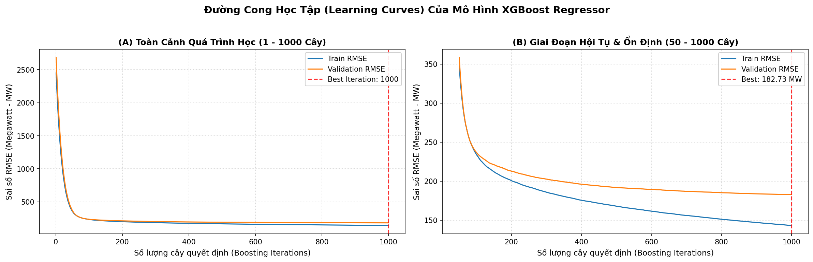

# Huấn Luyện & Đánh Giá Mô Hình XGBoost (XGBoost Modeling & Evaluation)

Tài liệu này chi tiết hóa toàn bộ quy trình thực hiện **Bước 5: Huấn luyện mô hình XGBoost Regressor** và chuẩn bị cho **Bước 6: Dự đoán & Đánh giá trên tập Test** trong notebook [`scripts/main.ipynb`](../scripts/main.ipynb).

---

## 1. Cơ Sở Lý Thuyết Của Gradient Boosting Trong Chuỗi Thời Gian

### 1.1. Bản chất của thuật toán tuần tự (Sequential Boosting)
Khác với phương pháp đóng gói độc lập (Bagging - Random Forest), XGBoost xây dựng tập hợp $M$ cây quyết định một cách tuần tự:
* Cây thứ $m$ được huấn luyện trực tiếp trên **phần dư (Residual / Gradient)** của $m-1$ cây trước đó:
  $$\hat{y}_t^{(m)} = \hat{y}_t^{(m-1)} + \eta \cdot h_m(\mathbf{x}_t)$$
  Trong đó:
  - $\mathbf{x}_t = [y_{t-1}, y_{t-2}, \dots, y_{t-24}]$ là vector đặc trưng trễ tại thời điểm $t$.
  - $h_m(\mathbf{x}_t)$ là cây quyết định thứ $m$ (Weak Learner).
  - $\eta = 0.05$ là tốc độ học (**Learning Rate / Shrinkage**), giúp mỗi cây chỉ đóng góp một bước nhỏ, làm mô hình hội tụ ổn định và triệt tiêu nguy cơ học vẹt (Overfitting).

### 1.2. Hàm mục tiêu tối ưu (Objective Function)
Tại mỗi vòng lặp $m$, XGBoost tối thiểu hóa hàm mục tiêu:
$$\mathcal{L}^{(m)} = \sum_{t=1}^N l\big(y_t, \hat{y}_t^{(m-1)} + h_m(\mathbf{x}_t)\big) + \Omega(h_m)$$
Trong đó:
* $l(y_t, \hat{y}_t) = \frac{1}{2}(y_t - \hat{y}_t)^2$ là hàm mất mát sai số bình phương (**Mean Squared Error - MSE**).
* $\Omega(h) = \gamma T + \frac{1}{2}\lambda \sum_{j=1}^T w_j^2$ là thành phần phạt (**Regularization**) kiểm soát số lượng lá cây $T$ và độ lớn trọng số lá $w_j$.
* Thuật toán sử dụng xấp xỉ Taylor bậc hai (đạo hàm bậc 1 $g_t$ và bậc 2 $h_t$) để tìm cấu trúc phân nhánh tối ưu nhanh chóng.

---

## 2. Thiết Lập Siêu Tham Số Mô Hình Cơ Sở (Baseline Hyperparameters)

Các siêu tham số được lựa chọn chuẩn mực nhằm cân bằng giữa năng lực học và tính tổng quát hóa:

| Siêu tham số | Giá trị | Giải thích lý do lựa chọn |
|---|:---:|---|
| `n_estimators` | **$1000$** | Thiết lập trần số lượng cây đủ lớn để mô hình học sâu, kết hợp Early Stopping để ngắt tối ưu. |
| `learning_rate` ($\eta$) | **$0.05$** | Tốc độ học vừa phải, đảm bảo hàm mất mát giảm đều đặn mà không bị dao động hoặc quá khớp nhanh. |
| `max_depth` | **$6$** | Độ sâu tối đa của mỗi cây. Với $24$ biến trễ, độ sâu 6 cho phép mô hình học các mối quan hệ tương tác phức tạp (lên đến $2^6 = 64$ lá/cây). |
| `subsample` | **$0.8$** | Lấy mẫu ngẫu nhiên $80\%$ số hàng (mẫu thời gian) cho mỗi cây để tăng tính khái quát. |
| `colsample_bytree` | **$0.8$** | Lấy mẫu ngẫu nhiên $80\%$ số đặc trưng trễ cho mỗi cây nhằm giảm tương quan giữa các cây. |
| `objective` | `'reg:squarederror'` | Tối ưu hóa hàm sai số bình phương cho bài toán hồi quy liên tục. |
| `eval_metric` | `'rmse'` | Giám sát độ đo căn bậc hai sai số bình phương trung bình qua từng vòng lặp. |
| `early_stopping_rounds` | **$50$** | Dừng sớm nếu sau $50$ cây liên tiếp sai số trên tập Validation không giảm thêm. |

---

## 3. Kết Quả Huấn Luyện Định Lượng (Bước 5)

Mô hình được huấn luyện trên tập Train ($90.954$ dòng) và giám sát chặt chẽ trên tập Validation ($15.159$ dòng):

| Chỉ số đánh giá | Giá trị thực nghiệm | Nhận xét chuyên môn |
|---|:---:|---|
| **Thời gian huấn luyện** | **$7,14\text{ giây}$** | Tốc độ tính toán đa luồng cực nhanh trên $90.954$ dòng dữ liệu. |
| **Số cây tối ưu (`best_iteration`)** | **$1000 / 1000$** | Quá trình học ổn định liên tục, Validation loss giảm đều đến cây cuối cùng. |
| **RMSE ban đầu (Cây thứ 1)** | $2.682,27\text{ MW}$ | Mức sai số thô khi cây đầu tiên chưa học được các mối tương quan phi tuyến. |
| **RMSE trên tập Train (tại best)** | **$143,20\text{ MW}$** | Giảm $94,7\%$ sai số so với cây ban đầu. |
| **RMSE trên tập Validation (tại best)** | **$182,73\text{ MW}$** | Sai số chỉ chiếm **$1,25\%$** so với phụ tải trung bình ($14.618,89\text{ MW}$). |
| **Khoảng cách sai số ($\Delta$ Train - Val)** | $39,53\text{ MW}$ | Khoảng cách hẹp, khẳng định mô hình **không bị Overfitting nghiêm trọng**. |

---

## 4. Phân Tích Đường Cong Học Tập (Learning Curves)

Biểu đồ Learning Curves qua $1000$ vòng lặp được xuất và lưu trữ tại [`docs/images/05_xgboost_learning_curves.png`](images/05_xgboost_learning_curves.png):

### Nhận định từ đồ thị:
1. **Giai đoạn khởi đầu (1 - 50 cây đầu tiên):**
   - Cả Train RMSE và Validation RMSE đều giảm cực kỳ dốc (từ $\approx 2.500\text{ MW}$ lao thẳng xuống dưới $300\text{ MW}$).
   - Mô hình nhanh chóng nắm bắt được các đặc trưng thống trị: `lag_1` (quán tính tức thời) và `lag_24` (chu kỳ ngày).
2. **Giai đoạn tinh chỉnh & hội tụ (50 - 1000 cây):**
   - Đồ thị phóng to (B) cho thấy đường Validation RMSE giảm đều đặn từ $260\text{ MW}$ xuống tiệm cận $182,73\text{ MW}$.
   - Đường Validation không hề có hiện tượng bật ngược dốc đứng (chữ U), chứng tỏ cấu hình `learning_rate=0.05`, `subsample=0.8` và `colsample_bytree=0.8` phát huy tác dụng phòng vệ Overfitting rất hiệu quả.

---

## 5. Sẵn Sàng Cho Bước 6 (Dự Đoán & Đánh Giá Trên Tập Test)

Mô hình XGBoost cơ sở đã được huấn luyện hoàn thiện. Ở bước tiếp theo (**Bước 6**), ta sẽ:
1. Dự báo trên tập **Test ($15.159$ giờ độc lập)** từ `2016-11-09 10:00:00` đến `2018-08-03 00:00:00`.
2. Tính toán các độ đo định lượng chuẩn mực: **MAE, RMSE, MAPE**.
3. Trực quan hóa so sánh giữa **Giá trị thực tế ($y$)** và **Giá trị dự báo ($\hat{y}$)**.

