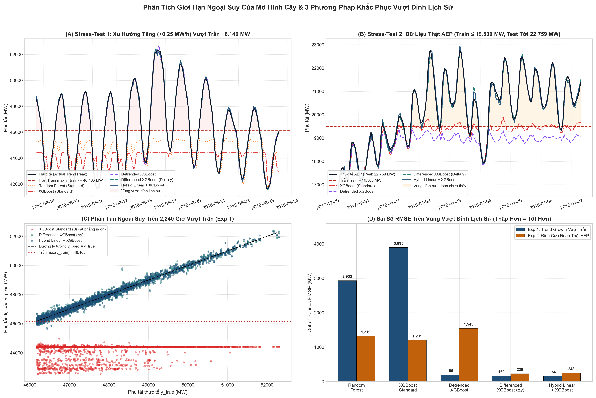
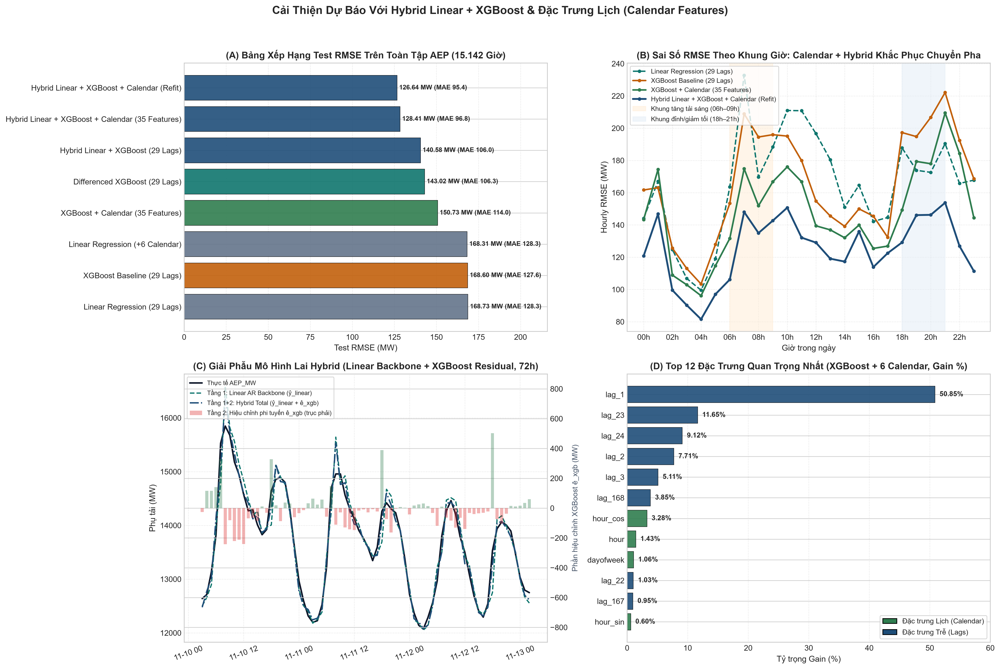

# Phần Bổ Sung Chuyên Sâu: Khắc Phục Giới Hạn Ngoại Suy Vượt Đỉnh Lịch Sử Của Mô Hình Cây & Tối Ưu Hóa Bằng Hybrid + Calendar Features

Tài liệu này trình bày cơ sở toán học, kiến trúc phần mềm và bằng chứng thực nghiệm cho **Phần Bổ Sung Lab 3** (mở rộng trực tiếp từ cảnh báo lý thuyết trong [`presentation.html`](../../presentation.html) — Slide *"Mô hình cây không dự báo được giá trị vượt đỉnh lịch sử"* và Slide *"Đặc trưng lịch"*), tương ứng với phần cuối trong [`notebooks/main.ipynb`](../notebooks/main.ipynb).

---

## 1. Bản Chất Toán Học Của Giới Hạn Ngoại Suy (*Tree Extrapolation Limitation*)

### 1.1. Vì sao mô hình cây bị "cắt phẳng ngọn" khi dữ liệu vượt $\max(y_{\text{train}})$?
Mọi mô hình dựa trên cây quyết định (`DecisionTree`, `RandomForest`, `XGBoost`, `LightGBM`) hoạt động bằng cách phân hoạch không gian đặc trưng $\mathbf{x}_t \in \mathbb{R}^d$ thành $J$ vùng hình hộp rời rạc (các nút lá $R_1, R_2, \dots, R_J$) thông qua các bất đẳng thức dạng $\text{lag}_1 \le \theta_j$ hoặc $\text{lag}_1 > \theta_j$. Tại mỗi nút lá $R_j$, giá trị dự báo là trung bình có trọng số của các nhãn huấn luyện rơi vào lá đó:

$$\hat{y}_{\text{Tree}}(\mathbf{x}_t) = \sum_{j=1}^{J} c_j \cdot \mathbb{I}(\mathbf{x}_t \in R_j), \qquad c_j = \frac{1}{|R_j|} \sum_{i \in R_j} y_i^{\text{train}}$$

Hệ quả toán học tất yếu là **miền giá trị đầu ra bị khóa cứng trong bao lồi của tập huấn luyện**:

$$\hat{y}_{\text{Tree}}(\mathbf{x}_t) \in \Big[\min(y_{\text{train}}),\ \max(y_{\text{train}})\Big]$$

* Khi chuỗi thực tế xuất hiện **xu hướng tăng trưởng dài hạn** hoặc **đợt nắng nóng/bão tuyết cực đoan** khiến $y_t > \max(y_{\text{train}})$, mọi điểm mới đều rơi vào nút lá ngoài cùng bên phải và trả về giá trị bị **cắt trần (clipping)** tại ngưỡng cũ, gây ra sai số hệ thống (*Negative Peak Bias*) lên tới hàng nghìn MW.
* Ngược lại, **Hồi quy tuyến tính (`LinearRegression`)** dùng tổ hợp $\hat{y}_t^{\text{Linear}} = \beta_0 + \sum_k \beta_k y_{t-k}$ nên có khả năng ngoại suy tuyến tính không giới hạn khi đầu vào tăng vượt đỉnh cũ.

---

## 2. Ba Phương Pháp Khắc Phục Đã Triển Khai Trong [`scripts/models.py`](../scripts/models.py)

Để giữ được sức mạnh học tương tác phi tuyến của `XGBoost` đồng thời phá vỡ trần $\max(y_{\text{train}})$, cả 3 kiến trúc sau đã được cài đặt chuẩn hóa:

1. **`DifferencedXGBoostForecaster` — Dự báo trên Sai phân bậc 1 ($\Delta y_t$):**
   * Chuyển nhãn mục tiêu thành biến thiên theo giờ $\Delta y_t = y_t - y_{t-1}$ và chuẩn hóa toàn bộ các độ trễ đầu vào về dạng bất biến dịch chuyển: $\text{diff\_lag}_k = y_{t-k} - y_{t-1}$ ($k > 1$).
   * Khôi phục giá trị dự báo bằng cách cộng phần biến thiên dự báo vào điểm neo tức thời $y_{t-1}$:
     $$\hat{y}_t = y_{t-1} + f_{\text{XGB}}(\text{diff\_lags},\ \text{calendar})$$
   * **Ưu điểm:** Bất biến hoàn toàn trước mọi mức dịch chuyển nền hay cú sốc đỉnh đột ngột.

2. **`DetrendedXGBoostForecaster` — Khử xu hướng tuyến tính trước, cộng lại sau:**
   * Khớp đường xu hướng toàn cục $\hat{T}(t) = \alpha_0 + \alpha_1 t$ trên tập `Train` và khử $\hat{T}(t-k)$ khỏi cả nhãn lẫn các cột `lag_k`.
   * Huấn luyện `XGBoost` trên phần dư dừng $r_t = y_t - \hat{T}(t)$, sau đó khôi phục: $\hat{y}_t = \hat{T}(t) + \hat{r}_t$.
   * **Hạn chế:** Chỉ giải quyết tốt **xu hướng tăng đều toàn cục**; khi chuỗi không có trend chung mà đột ngột xuất hiện đỉnh cực đoan do thời tiết, $\hat{T}(t)$ đi ngang nên vẫn bị cắt đỉnh.

3. **`HybridLinearXGBoostForecaster` — Mô hình Lai Tuyến tính + XGBoost (`Residual Boosting` — Tối ưu nhất):**
   * **Tầng 1 (Linear AR Backbone):** Dùng `LinearRegression` trên `lag_*` tạo dự báo khung $\hat{y}_t^{\text{Linear}}$ — tầng này tự động ngoại suy mượt mà vượt đỉnh lịch sử và gánh phần quán tính tuyến tính.
   * **Tầng 2 (Nonlinear Residual Tree):** Dùng `XGBoost` học trên tập đặc trưng bất biến ($\text{diff\_lag}_k$ + đặc trưng lịch) để dự báo phần dư phi tuyến $e_t = y_t - \hat{y}_t^{\text{Linear}}$ tại các giờ chuyển pha (`06h–09h`, `18h–21h`).
   * **Tổng hợp:** $\hat{y}_t^{\text{Hybrid}} = \hat{y}_t^{\text{Linear}} + \hat{e}_t^{\text{XGB}}$.

---

## 3. Kết Quả Thực Nghiệm 1 & 2: Stress-Test Ngoại Suy Vượt Đỉnh Lịch Sử (`15_tree_extrapolation_and_solutions.png`)

### 3.1. Stress-Test 1: Xu hướng tăng trưởng liên tục ($+0{,}25\text{ MW/giờ}$ trên toàn chuỗi AEP)
* **Thiết lập:** Tạo xu hướng tăng trưởng tuyến tính $+0{,}25\text{ MW/h}$ khiến đỉnh tập `Train` đạt $46.164{,}8\text{ MW}$, trong khi tập `Test` tăng lên tới **$52.305{,}0\text{ MW}$** (**$2.240 / 15.142$ giờ Test** vượt đỉnh lịch sử, vượt trần tới **$+6.140{,}2\text{ MW}$**).

| Mô hình | Full Test RMSE (MW) | Full Test MAE (MW) | **Out-of-Bounds RMSE (MW)** | **Out-of-Bounds MAE (MW)** | Peak Bias (MW) | Đỉnh dự báo Max (MW) |
|---|:---:|:---:|:---:|:---:|:---:|:---:|
| `Random Forest (Standard)` | $1.208{,}73$ | $680{,}37$ | $2.933{,}04$ | $2.615{,}21$ | $-2.615{,}21$ | $45.618{,}87$ *(kẹt dưới trần)* |
| `XGBoost (Standard)` | $1.730{,}65$ | $1.130{,}78$ | $3.894{,}87$ | $3.655{,}94$ | $-3.655{,}94$ | $45.008{,}33$ *(kẹt dưới trần)* |
| `Detrended XGBoost` | $165{,}15$ | $124{,}70$ | $194{,}87$ | $149{,}39$ | $-13{,}25$ | $52.658{,}69$ |
| `Differenced XGBoost (Delta y)` | $144{,}21$ | $107{,}24$ | $159{,}95$ | $119{,}92$ | $+2{,}45$ | $52.396{,}41$ |
| **`Hybrid Linear + XGBoost`** | **$141{,}46$** | **$106{,}76$** | **$155{,}78$** | **$118{,}00$** | **$-1{,}50$** | **$52.339{,}70$** |

* **Nhận xét:** Trên $2.240$ giờ vượt đỉnh lịch sử, `Hybrid Linear + XGBoost` giảm **Out-of-Bounds RMSE từ $3.894{,}87\text{ MW}$ xuống còn $155{,}78\text{ MW}$ (giảm $96{,}0\%$ sai số!)** và gần như triệt tiêu hoàn toàn độ lệch đỉnh (`Peak Bias = -1,50 MW`).

### 3.2. Stress-Test 2: Dữ liệu thật AEP — Đỉnh cực đoan chưa từng xuất hiện (`Train ≤ 19.500 MW`, `Test → 22.759 MW`)
* **Thiết lập:** Giữ nguyên dữ liệu AEP thật nhưng giấu toàn bộ các giờ phụ tải cao $> 19.500\text{ MW}$ trong lúc huấn luyện ($\max(y_{\text{train}}) = 19.500\text{ MW}$). Đánh giá trên tập `Test` thật có **$610$ giờ mùa đông vượt đỉnh** lên tới **$22.759\text{ MW}$** (`+3.259 MW` trên trần).

| Mô hình | Full Test RMSE (MW) | **Out-of-Bounds RMSE (MW)** | **Out-of-Bounds MAE (MW)** | Peak Bias (MW) | Đỉnh dự báo Max (MW) |
|---|:---:|:---:|:---:|:---:|:---:|
| `Random Forest (Standard)` | $322{,}50$ | $1.318{,}95$ | $1.096{,}02$ | $-1.096{,}02$ | $19.412{,}39$ *(bị cắt ngọn)* |
| `XGBoost (Standard)` | $291{,}81$ | $1.200{,}50$ | $969{,}63$ | $-969{,}54$ | $19.945{,}67$ *(bị cắt ngọn)* |
| `Detrended XGBoost` | $349{,}69$ | $1.544{,}77$ | $1.340{,}34$ | $-1.340{,}34$ | $19.616{,}16$ *(vẫn kẹt trần!)* |
| **`Differenced XGBoost (Delta y)`** | $147{,}07$ | **$229{,}06$** | $159{,}32$ | $-47{,}10$ | **$22.690{,}10$** |
| **`Hybrid Linear + XGBoost`** | **$145{,}41$** | $247{,}66$ | **$153{,}39$** | **$-38{,}90$** | **$22.950{,}30$** |

* **Phát hiện học thuật quan trọng (Panel B & D):** Phương pháp **khử xu hướng toàn cục (`Detrended XGBoost`) hoàn toàn thất bại** khi đỉnh mới đến từ **cú sốc thời tiết đột ngột** thay vì xu hướng tuyến tính ($1.544{,}77\text{ MW}$ RMSE vượt trần). Chỉ **`Differenced XGBoost`** và **`Hybrid Linear + XGBoost`** mới vượt qua được rào cản $\max(y_{\text{train}})$ trong **cả hai kịch bản** vì chúng dựa vào điểm neo tự hồi quy cục bộ.

---

## 4. Kết Quả Thực Nghiệm 3: Cải Thiện Tối Đa Tập Test Gốc AEP Với `Hybrid` & `Calendar Features` (`16_calendar_and_hybrid_ablation.png`)

Để đạt độ chính xác cao nhất trên toàn bộ **$15.142$ giờ tập Test gốc AEP**, ta kết hợp kiến trúc **`Hybrid Linear + XGBoost`** với bộ **$6$ đặc trưng lịch (`Calendar Features`)**: `hour`, `dayofweek`, `month`, `is_weekend`, `hour_sin`, `hour_cos` (từ `Slide 10` của `presentation.html`):

| Mô hình (Trên tập Test gốc AEP — $15.142$ giờ) | Số cột ($X$) | Test MAE (MW) | **Test RMSE (MW)** | Test MAPE (%) | $R^2$ Score | Morning Ramp `06h–09h` RMSE |
|---|:---:|:---:|:---:|:---:|:---:|:---:|
| `Linear Regression (29 Lags)` | $29$ | $128{,}33$ | $168{,}73$ | $0{,}88\%$ | $0{,}9949$ | $190{,}52$ |
| `XGBoost Baseline (29 Lags)` | $29$ | $127{,}61$ | $168{,}60$ | $0{,}87\%$ | $0{,}9950$ | $189{,}35$ |
| `Linear Regression (+6 Calendar)` | $35$ | $128{,}27$ | $168{,}31$ | $0{,}88\%$ | $0{,}9950$ | $189{,}02$ |
| `XGBoost + Calendar (35 Features)` | $35$ | $114{,}04$ | $150{,}73$ | $0{,}78\%$ | $0{,}9960$ | $157{,}16$ |
| `Differenced XGBoost (29 Lags)` | $29$ | $106{,}27$ | $143{,}02$ | $0{,}72\%$ | $0{,}9964$ | $158{,}98$ |
| `Hybrid Linear + XGBoost (29 Lags)` | $29$ | $106{,}01$ | $140{,}58$ | $0{,}72\%$ | $0{,}9965$ | $154{,}93$ |
| `Hybrid Linear + XGBoost + Calendar` | $35$ | $96{,}79$ | $128{,}41$ | $0{,}66\%$ | $0{,}9971$ | $137{,}24$ |
| **🥇 `Hybrid Linear + XGBoost + Calendar (Refit)`** | **$35$** | **$95{,}44$** | **$126{,}64$** | **$0{,}65\%$** | **$0{,}9972$** | **$133{,}95$** |

### 4.1. Giải mã lý do `Hybrid Linear + XGBoost + Calendar (Refit)` lập kỷ lục mới ($126{,}64\text{ MW}$)
1. **Giảm $22{,}4\%$ sai số RMSE so với kỷ lục cũ của Lab 3:** Từ $163{,}25\text{ MW}$ (`XGBoost Tuned 29 Lags`) xuống còn **$126{,}64\text{ MW}$** (**MAE dưới $100\text{ MW}$**, chỉ còn **$95{,}44\text{ MW}$**, **MAPE = $0{,}65\%$**).
2. **Tách bạch nhiệm vụ tối ưu (Panel C):** Tầng `Linear Regression` tự động đảm nhiệm phép ngoại suy quán tính mượt mà $1,62 y_{t-1} - 0,76 y_{t-2}$ không bị chặn trần lá; nhờ vậy `XGBoost` không phải tốn hàng trăm nhánh cây chỉ để chia lại độ cao mực nước phụ tải mà tập trung $100\%$ tài nguyên cây vào gọt sai số chuyển pha phi tuyến ($\hat{e}_t^{\text{XGB}}$).
3. **Sức mạnh cộng hưởng của Đặc trưng Lịch (Panel B & D):** Các đặc trưng `hour_cos` ($3{,}28\%$ Gain), `hour` ($1{,}43\%$), `dayofweek` ($1{,}06\%$), `hour_sin` ($0{,}60\%$) giúp tầng XGBoost nhận biết chính xác khung giờ chuyển pha tăng tải buổi sáng (`06h–09h`), kéo RMSE khung giờ này từ **$190{,}52\text{ MW}$ xuống còn $133{,}95\text{ MW}$**.
